<h1 align="center">OpEnd Brasil</h1>

<p align="center">
  <strong>Aberturas e encerramentos de anime para ouvir como playlist ou assistir em vídeo.</strong><br />
  OP &amp; ED · アニソン
</p>

<p align="center">
  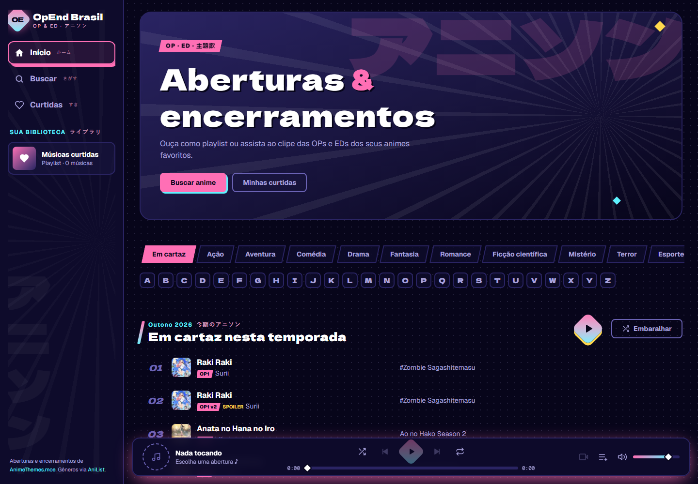
</p>

---

## Sobre o projeto

O **OpEnd Brasil** é um player de músicas de anime. Você busca um anime, escolhe a abertura (OP) ou o encerramento (ED) e escuta só o áudio enquanto navega pelo site, ou abre o clipe em tela grande, que continua do ponto em que o áudio estava.

O visual mistura Tóquio à noite com páginas de mangá: retícula, linhas de velocidade, quadros com sombra sólida e títulos com legendas em japonês.

Os vídeos e os dados vêm do [AnimeThemes.moe](https://animethemes.moe), um arquivo feito por fãs, e os gêneros vêm do [AniList](https://anilist.co). Nenhum vídeo é hospedado neste projeto: o player toca direto dos servidores do AnimeThemes.

## Funcionalidades

- **Player que não para:** a música continua tocando enquanto você troca de página.
- **Áudio ou vídeo:** alterne entre ouvir só o áudio (arquivo mais leve) e assistir ao clipe, sem perder o ponto da música.
- **Fila de reprodução:** tocar tudo, embaralhar, repetir a fila ou uma música, adicionar e remover músicas da fila.
- **Curtidas:** monte sua playlist de favoritas, salva no próprio navegador, sem login.
- **Temporada atual:** a página inicial mostra o que está em exibição agora e o que passou na temporada anterior.
- **Gêneros:** Ação, Aventura, Romance, Comédia, Terror, Esportes e outros, ordenados por popularidade.
- **Catálogo de A a Z** e **por formato** (séries de TV, filmes, OVAs, ONAs, especiais), com paginação.
- **Busca** por nome do anime ou da música.
- **Controles do sistema:** play, pausa e troca de faixa pela tela de bloqueio, pelo fone de ouvido e pela barra de espaço.
- **Responsivo:** barra lateral no computador, menu hambúrguer e player compacto no celular.

## Prints

### Página do anime

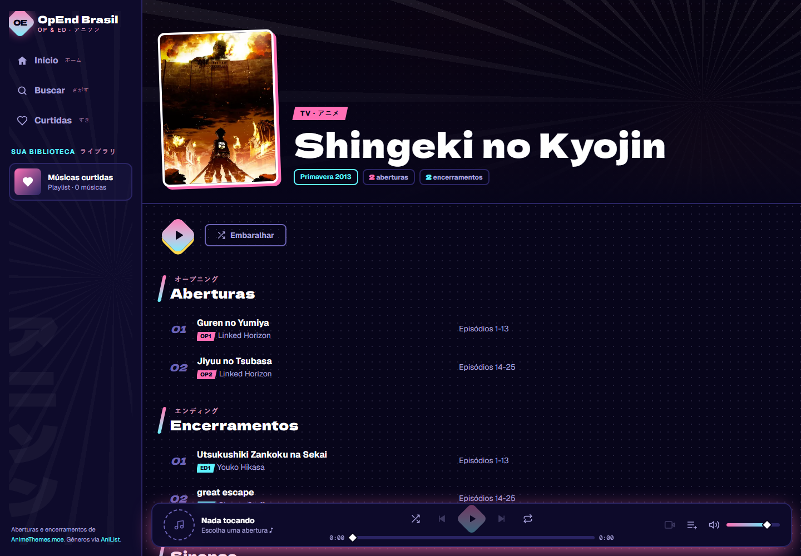

### Tocando uma abertura

A capa vira um disco que gira enquanto a música toca, e a faixa atual ganha destaque na lista.

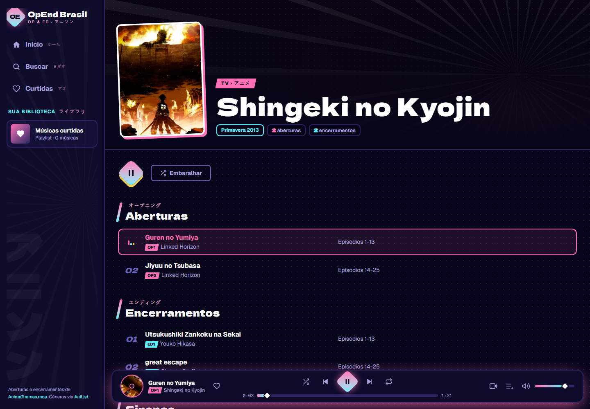

### Modo vídeo

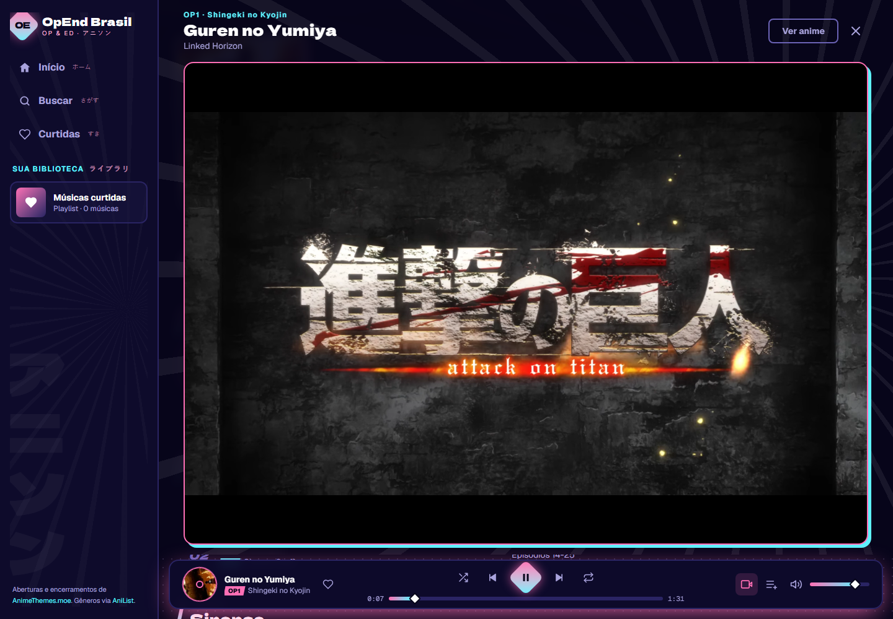

### Gêneros e temporadas

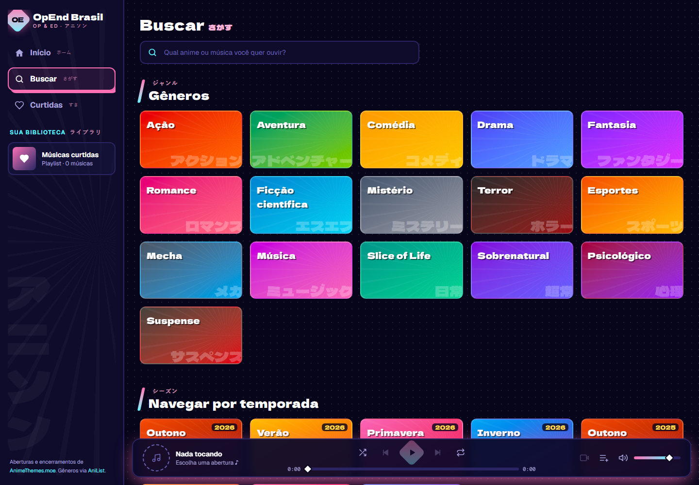

<table>
  <tr>
    <td>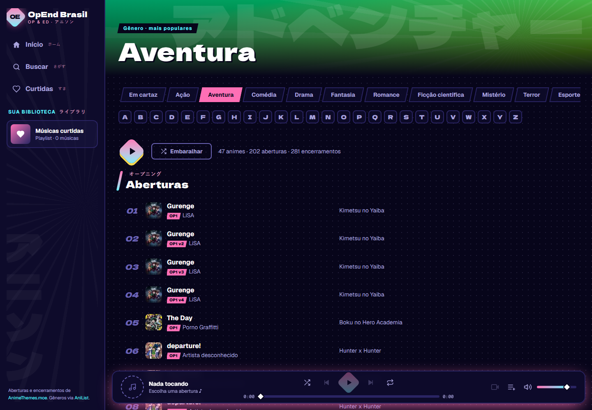</td>
    <td>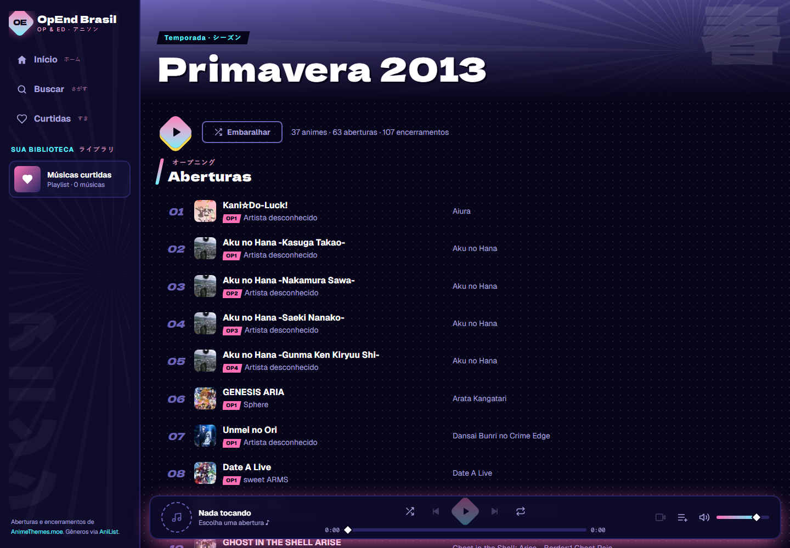</td>
  </tr>
  <tr>
    <td align="center">Gênero Aventura</td>
    <td align="center">Temporada Primavera 2013</td>
  </tr>
</table>

### Busca

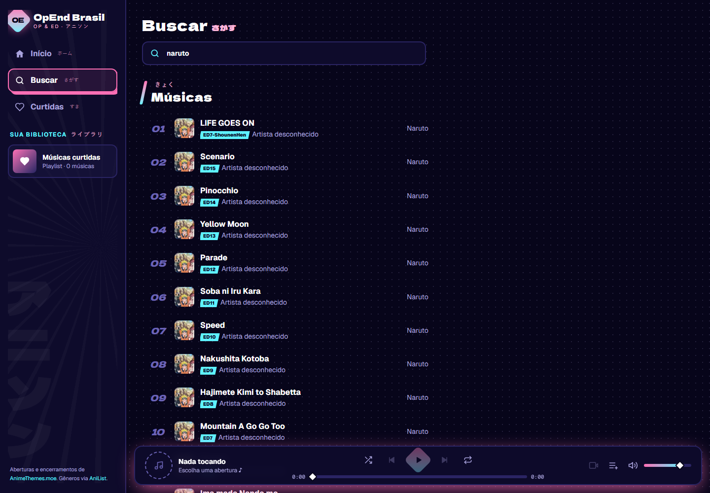

### No celular

<table>
  <tr>
    <td>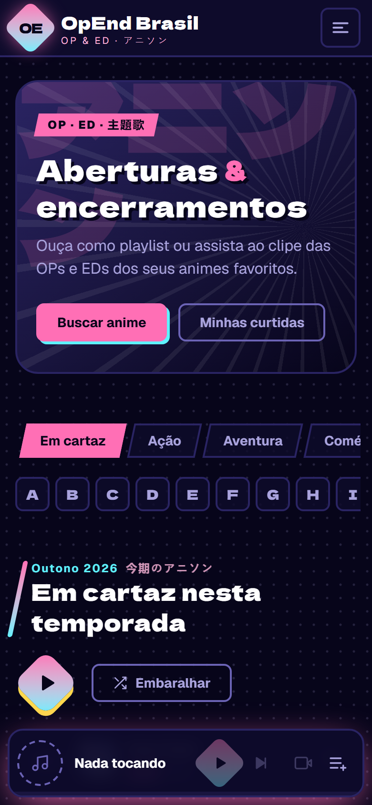</td>
    <td>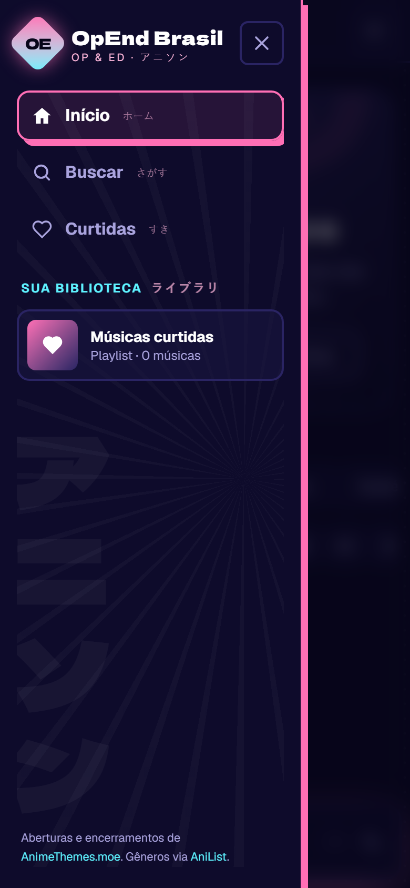</td>
    <td>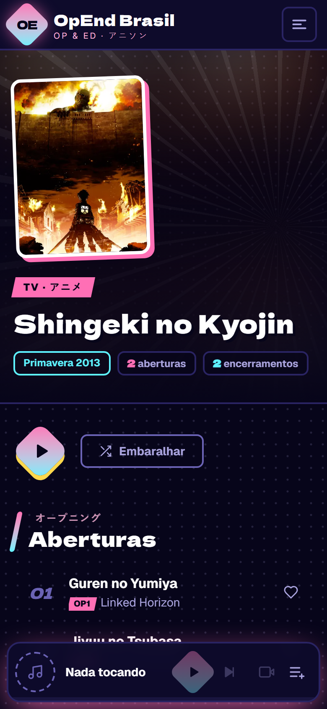</td>
  </tr>
  <tr>
    <td align="center">Início</td>
    <td align="center">Menu</td>
    <td align="center">Página do anime</td>
  </tr>
</table>

## Tecnologias

| Tecnologia | Uso |
| --- | --- |
| [Next.js 16](https://nextjs.org) (App Router) | Páginas, rotas e renderização no servidor |
| Cache Components (`"use cache"`) | Cache das respostas das APIs, para o site carregar rápido e respeitar o limite de pedidos |
| [React 19](https://react.dev) | Interface e estado do player |
| [Tailwind CSS 4](https://tailwindcss.com) | Toda a estilização, com as cores do tema definidas em `@theme` |
| TypeScript | Tipagem de ponta a ponta |
| `next/image` | Capas redimensionadas e otimizadas |
| [AnimeThemes API](https://api-docs.animethemes.moe) | Animes, músicas, vídeos e áudios |
| [AniList GraphQL](https://docs.anilist.co) | Animes mais populares de cada gênero |

Não é preciso criar conta nem chave de API: as duas APIs são públicas e gratuitas.

## Como executar

### Pré-requisitos

- [Node.js](https://nodejs.org) **20.9 ou mais recente**
- npm (já vem com o Node.js)
- Git

Para conferir as versões instaladas:

```bash
node --version
npm --version
```

### 1. Clonar o repositório

```bash
git clone https://github.com/Matheussmaced/opend-brasil.git
cd opend-brasil
```

### 2. Instalar as dependências

```bash
npm install
```

### 3. Rodar em modo de desenvolvimento

```bash
npm run dev
```

Abra [http://localhost:3000](http://localhost:3000) no navegador.

A primeira visita a cada página demora alguns segundos, porque o Next.js compila a página na hora e busca os dados nas APIs. As visitas seguintes usam o cache e abrem quase na hora.

### 4. Gerar a versão de produção (opcional)

```bash
npm run build
npm start
```

A versão de produção fica em [http://localhost:3000](http://localhost:3000) e é bem mais rápida que o modo de desenvolvimento, porque as páginas principais já vêm prontas do build.

### Scripts disponíveis

| Comando | O que faz |
| --- | --- |
| `npm run dev` | Inicia o servidor de desenvolvimento em `localhost:3000` |
| `npm run build` | Gera a versão de produção na pasta `.next` |
| `npm start` | Roda a versão de produção (precisa do `build` antes) |
| `npm run lint` | Verifica o código com o ESLint |
| `npm run typecheck` | Verifica os tipos com o TypeScript |
| `npm run check` | Roda `typecheck` e `lint` juntos |
| `npm run build:verify` | Faz um build de teste na pasta `.next-verify`, sem atrapalhar um `npm run dev` que esteja rodando |

## Estrutura do projeto

```
app/                          Rotas (App Router)
  page.tsx                    Início
  anime/[slug]/               Página de um anime
  explorar/[tipo]/[valor]/    Gênero, letra (A-Z) ou formato
  temporada/[year]/[season]/  Temporada
  search/                     Busca
  curtidas/                   Músicas curtidas
  globals.css                 Tema: cores, fontes e animações

components/
  player/                     Player: estado, fila, controles, disco e modo vídeo
  track/                      Lista de músicas, botões de tocar e embaralhar
  anime/                      Cards, fileiras, grade e topo da página do anime
  catalog/                    Abas de categoria, A-Z, quadros de gênero e paginação
  layout/                     Barra lateral, menu hambúrguer e logo
  ui/                         Componentes básicos (botões, slider, capa, títulos)

lib/
  animethemes/                Cliente da API, conversão dos dados e consultas com cache
  anilist.ts                  Gêneros populares via AniList
  categories.ts               Lista de gêneros e formatos
  seasons.ts                  Temporadas do ano
  likes.ts                    Curtidas salvas no navegador
  site.ts                     Nome e descrição do site
```

## Como funciona

- **Dados:** as páginas buscam os dados no servidor e guardam o resultado em cache: temporadas e animes por algumas horas, gêneros e catálogo por um dia. Isso deixa o site rápido e evita estourar o limite de pedidos das APIs.
- **Gêneros:** o AnimeThemes não tem gêneros. O site pede ao AniList os animes mais populares de cada gênero e cruza com o AnimeThemes pelo código do AniList, que ele já guarda.
- **Player:** existe um único elemento de mídia na página inteira, por isso a música não para ao trocar de página. No modo áudio ele toca o arquivo `.ogg`, mais leve; no modo vídeo troca para o `.webm` e continua do mesmo segundo.
- **Curtidas:** ficam no `localStorage` do navegador. Não há banco de dados nem login.

## Créditos e aviso

- Vídeos, áudios e dados das músicas: [AnimeThemes.moe](https://animethemes.moe).
- Gêneros e popularidade: [AniList](https://anilist.co).
- As aberturas, os encerramentos, as capas e as sinopses pertencem aos seus respectivos estúdios, gravadoras e autores.

Este é um projeto de fã, sem fins lucrativos e sem vínculo com os estúdios ou com as fontes acima. O site não hospeda nenhum vídeo: tudo é transmitido direto do AnimeThemes, como o próprio projeto recomenda.
